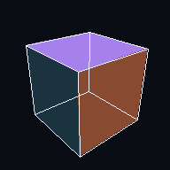

# Arzin Lab

A builder's lab for taking ideas to working software while understanding **every layer
underneath**: how 3D works, how physics simulations work, how databases store data, how
networks are defended, and how agents loop.

Everything shows up in one place: **the Hub**, a 3D dashboard that runs in the browser and
installs on an iPhone like an app.



## Layout

```
arzin-lab/
├── hub/        The Hub: TypeScript + three.js dashboard (PWA, installable on iPhone)
├── scenes/     Scene files (JSON). Anyone, or any AI agent, can write one to visualize something
├── modules/    From-scratch learning modules, each with a NOTES.md explaining the concepts
│   └── 01-3d-from-scratch/   A 3D renderer in pure Python: matrices → pixels
└── games/      Godot projects (coming)
```

## Run it

**Hub (on your computer):**
```bash
cd hub
npm install
npm run dev
```
Then open http://localhost:5173. Your phone can open the "Network" URL Vite prints, as long
as it's on the same Wi-Fi.

**Hub (on your iPhone):** every push to `main` deploys it to GitHub Pages. Open the Pages URL
in **Safari → Share → Add to Home Screen**. It then opens full-screen and works offline.

**Module 01:**
```bash
cd modules/01-3d-from-scratch
python step1_points.py
```

## Tracks

| # | Track | Status |
|---|---|---|
| 1 | 3D Fundamentals: renderer from scratch, pipeline explainer, model viewer | **active** |
| 2 | Math & Textbook Visuals: surfaces, curves, vectors from equations | **active** |
| 3 | Physics & Simulation: integrators, projectile/spring/orbit labs | next |
| 4 | Software Engineering: loop stepper, call stack, what makes an app shippable | planned |
| 5 | Data & Databases: B-trees, write-ahead log, backup/restore visualizers | planned |
| 6 | Cybersecurity & Networks: defensible network design in 3D | planned |
| 7 | Games & RPG: Godot 4, game loop, state machines, inventory, saves | planned |
| 8 | Prompt & Loop Engineering: agents that use the Hub to explain things | planned |
| 9 | Strange Tools: small weird useful things | planned |

## Tech choices (and why)

- **three.js + TypeScript** for the Hub: a real WebGL/WebGPU 3D engine. It's the only way to
  put the same 3D app on Windows and an iPhone without a Mac or the App Store.
- **Godot 4** for games: a free, open-source, real game engine. Its web export can be embedded in the Hub.
- **Pure Python** for from-scratch modules: no libraries, so nothing is hidden.
- **mathjs** for formulas in scene files: parses math safely, with no `eval`.
